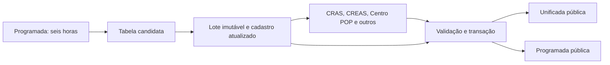

# Publicação pareada: programada e planilha unificada

A referência oficial dos atendimentos é o **resultado materializado** da consulta
programada `acolherio_atendimentos_dev`. O publicador garante, no mesmo lote:

```text
SUM(unificada.atendimentos.quantidade)
  = COUNT(DISTINCT (programada.SEQ_ATENDIMENTO, programada.modulo))
```

Os conjuntos de PKs e os usuários associados também devem ser idênticos. A
programada tem uma linha por atendimento/profissional; a unificada tem uma linha
por usuário, com eventos e profissionais em listas. Portanto, não se compara o
`COUNT(*)` das duas tabelas. A lista de profissionais não multiplica a medida.

## Fluxo



A consulta mantém suas regras e credenciais; muda somente o destino para
`rj-smas-dev.dashboard_acolherio.dev_atendimentos_candidata`. O worker lê essa tabela
nativa BigQuery, sem reexecutar o SQL que acessa a planilha externa de e-mails.

O Prefect verifica uma versão nova a cada cinco minutos. A concorrência é um,
com descarte de verificações redundantes enquanto há processamento ativo. Os
quatro serviços usam subprocessos dbt independentes e a mesma referência. As
quatro dimensões precisam terminar antes de publicar: não existe publicação
parcial de um serviço nesta versão.

O lote reconstrói `dim_usuarios` e suas dependências em `pu_build_<lote>`, usando
os modelos existentes e um schema privado. Depois congela as entradas em
`pu_base_<lote>`. Nenhuma tabela compartilhada do core é reconstruída por esse
processo. A captura compara os metadados das origens antes/depois e exige que
todos os usuários da referência existam no cadastro atualizado.

O conjunto de atendimentos vem exclusivamente da referência. Os antigos filtros
adicionais de família, cancelamento ou deduplicação da unificada não retiram PKs
que a referência publicou. A identidade interna inclui o módulo; o
`ID_ATENDIMENTO` legado por profissional não serve como PK do evento.

As dimensões preservam uma linha por usuário com pelo menos um atendimento ou
uma evolução no serviço. Evoluções mantêm suas regras de paciente explícito,
cancelamento, descrição legível e formulários. Usuários sem atendimento da
referência continuam no cadastro, com quantidade zero e registros vazios.

## Contrato da unificada

Continuam os cinco blocos `usuario`, `familias`, `projetos_sociais`, `atendimentos`
e `evolucoes`. Nos dois últimos:

```text
quantidade INT64
quantidade_por_servico STRUCT<cras INT64, creas INT64, centro_pop INT64, outros INT64>
registros ARRAY<STRUCT<...detalhes...>>
```

O total é o tamanho da lista e a soma das quatro contagens. A classificação usa a
unidade, com equipamentos desconhecidos no complemento `outros`. IDs técnicos
permanecem nos intermediários; nomes, exceções de IDs e textos ausentes como
branco continuam na apresentação. Horas são normalizadas para `HH:MM`.

## Construção e revisão sem publicar

A partir da raiz do repositório, usando o ambiente e as credenciais configurados:

```bash
.venv/bin/python queries/operations/planilha_unificada.py semear-referencia
.venv/bin/python queries/operations/planilha_unificada.py preparar --lote lote_exemplo
.venv/bin/python queries/operations/planilha_unificada.py dimensao --lote lote_exemplo --execucao execucao_exemplo --servico cras
.venv/bin/python queries/operations/planilha_unificada.py dimensao --lote lote_exemplo --execucao execucao_exemplo --servico creas
.venv/bin/python queries/operations/planilha_unificada.py dimensao --lote lote_exemplo --execucao execucao_exemplo --servico centro_pop
.venv/bin/python queries/operations/planilha_unificada.py dimensao --lote lote_exemplo --execucao execucao_exemplo --servico outros
.venv/bin/python queries/operations/planilha_unificada.py consolidar --lote lote_exemplo --execucao execucao_exemplo --servicos cras creas centro_pop outros
```

`semear-referencia` cria a candidata a partir da programada pública somente quando
ela ainda não existe. Esses comandos escrevem apenas em áreas isoladas. A
consolidação exige os quatro serviços, testes aprovados, mesmo lote e mesma versão
da referência. Eventos conflitantes, usuário ausente ou anti-join não vazio
impedem a aprovação.

## Deploy e ativação

O deployment `planilha-unificada-staging` nasce pausado. O CD da branch staging
publica a imagem, registra o deployment e executa a ativação dentro dessa mesma
imagem, usando as configurações já existentes do GitHub Actions.

A ativação pode ser executada manualmente com o perfil remoto configurado:

```bash
.venv/bin/python -m queries.operations.ativar_paridade --checar
.venv/bin/python -m queries.operations.ativar_paridade
```

O canário remoto valida a imagem/protocolo `programada_v2`, acesso BigQuery e
leitura da configuração da transferência. Sem endpoint, autenticação ou worker
saudável, nenhuma alteração no produtor é feita.

Após o canário, a ativação preserva a configuração original em
`rj-smas-dev.pu_coordenacao.programada_config_original`, pausa a transferência,
exige o término de jobs antigos, redireciona a saída candidata e processa o lote.
Só então publica o par, habilita o deployment e retoma a agenda de seis horas.
Se a etapa falhar depois da pausa, o produtor permanece pausado para que o erro
seja corrigido e a ativação retomada; não se restaura automaticamente um escritor
independente da tabela pública.

```bash
# Depois da ativação, um ciclo manual usa a mesma coordenação do Prefect.
.venv/bin/python queries/operations/planilha_unificada.py ciclo
```

O publicador verifica que a transferência já está redirecionada e que não há
jobs antigos escrevendo no destino público. Uma transação DML substitui as quatro
dimensões, unificada, programada pública e metadados juntos. Antes do COMMIT,
novas assertions conferem PKs, usuários, unicidade e contagens nas tabelas públicas.
Uma divergência desfaz ambas as saídas. A geração impede sobrescrita por candidato
antigo, e há bloqueios entre publicadores, inclusive execuções manuais.

A versão processada é identificada pelo fingerprint da materialização, não pelo
texto SQL: a mesma consulta pode produzir outra seleção de PKs na deduplicação.
Uma candidata nova durante o processamento será atendida no próximo ciclo, sem
alterar o lote em andamento. As duas saídas públicas continuam na última geração
pareada válida até o próximo COMMIT.

Os bloqueios expiram em cinco horas, acima do limite de quatro horas do fluxo.
Uma falha normal libera o bloqueio imediatamente. A ativação registra backup do
SQL/configuração e o publicador mantém cópias pareadas das saídas anteriores na
área candidata para auditoria/recuperação. Os artefatos dbt ficam em
`queries/target/pu/<execucao>/<etapa>`.

## Consulta de conciliação

Execute a comparação em uma única consulta, para ler o mesmo instante:

```sql
WITH referencia AS (
  SELECT DISTINCT CONCAT(CAST(SEQ_ATENDIMENTO AS STRING), modulo) AS chave,
                  CAST(ID_USUARIO AS STRING) AS id_usuario
  FROM `rj-smas-dev.dashboard_acolherio.dev_atendimentos`
), unificada AS (
  SELECT a.id_atendimento_modulo AS chave, p.usuario.id_usuario
  FROM `rj-smas-dev.relatorio.planilha_unificada` AS p,
       UNNEST(p.atendimentos.registros) AS a
)
SELECT COUNTIF(r.chave IS NOT NULL) AS atendimentos_programada,
       COUNTIF(u.chave IS NOT NULL) AS atendimentos_unificada,
       COUNTIF(u.chave IS NULL) AS somente_programada,
       COUNTIF(r.chave IS NULL) AS somente_unificada,
       COUNTIF(r.chave IS NOT NULL AND u.chave IS NOT NULL
               AND r.id_usuario IS DISTINCT FROM u.id_usuario) AS usuarios_divergentes
FROM referencia AS r
FULL OUTER JOIN unificada AS u USING (chave);
```

O controle `rj-smas-dev.relatorio.controle_planilha_unificada_publicacoes` registra
serviço, lote, execução, horários, geração e `referencia_versao`. Há uma linha
adicional `programada`, na mesma geração da unificada e das quatro dimensões.

## Validação e diagnóstico inicial

A AED de 26/10/2026 encontrou 1.017.864 atendimentos na unificada e 1.021.410 na
programada, embora esta tivesse 1.050.540 linhas por profissional. Havia 11.042 PKs
somente na programada e 7.496 somente na unificada. As causas eram o fato/cadastro
congelados e as regras de elegibilidade/deduplicação diferentes. O novo lote
candidato `l20261026_paridade` contém 586.840 usuários, 1.021.410 atendimentos e
654.748 evoluções. A comparação por PK e usuário com a referência passou sem
exclusivos em qualquer direção. Esses valores não são fixados no código.

```bash
RUN_BIGQUERY_TESTS=1 .venv/bin/python -m unittest discover -s queries/tests/planilha_unificada -p 'test_*.py' -v
```

A suíte cobre módulo na PK, vários profissionais/CBOs, profissional desconhecido,
elegibilidade da referência, associação do paciente, textos e horários, contagem
igual com PK errada, rollback pareado, geração antiga, candidato alterado e
proteção contra ativação sem Prefect. Os testes de transação usam apenas tabelas
temporárias BigQuery.

A publicação coordenada é restrita a staging/dev em `rj-smas-dev`. A limpeza
continua explícita e recusa bases/candidatos referenciados ou em processamento.

## Restrição de propriedade na primeira ativação

O canário do worker passou em 26/10/2026. A alteração do SQL da transferência
foi recusada tanto para a conta do deploy quanto para a credencial local:
`Cannot modify restricted parameters without taking ownership of the transfer configuration`.
A consulta pertence a `smas-luisa.pilar@dados.rio`. Sua identidade de execução foi
preservada, pois a consulta lê uma tabela externa do Drive. A transferência ficou
pausada e o deployment pareado também permanece pausado; as tabelas públicas não
foram substituídas. O lote validado permanece na área candidata.

Para concluir, a proprietária deve editar a consulta programada
`acolherio_atendimentos_dev` (configuração
`68e47fbc-0000-27ab-b6f9-883d24faad98`, região `us`) e trocar somente o destino
do `CREATE OR REPLACE TABLE`:

```sql
CREATE OR REPLACE TABLE `rj-smas-dev.dashboard_acolherio.dev_atendimentos_candidata`
```

Preservar todo o restante do SQL e manter a transferência pausada. Depois,
executar novamente o CD da branch staging com a correção de retomada. A ativação
reconhece o destino aplicado sem tentar reescrever parâmetros restritos, refaz o
canário, publica o par validado, habilita o Prefect e retoma a transferência.
Não habilitar isoladamente a consulta antiga apontando para a tabela pública.

O SQL completo com apenas essa substituição e os parâmetros para a API estão em
`/opt/pipelines/temp/programada-destino-candidata.sql` e
`/opt/pipelines/temp/programada-parametros-candidata.json`. O guia também está
copiado para `/opt/pipelines/temp/implementacao-dimensoes-planilha-unificada.md`.
