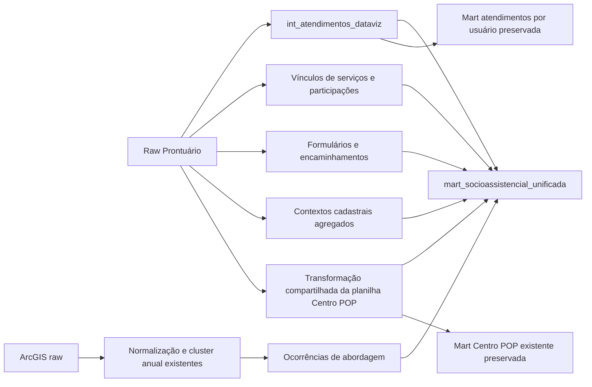

# Supertabela socioassistencial unificada

`mart_socioassistencial_unificada` é uma nova tabela física de consumo, construída
em paralelo às marts atuais. Centraliza fatos e evidências disponíveis para RMAs,
Planilha Unificada Centro POP e dataviz geral. Não representa homologação de todos
os indicadores oficiais. A migração dos consumidores é posterior.

- [Cobertura de cada indicador RMA](socioassistencial_cobertura_rma.md).
- [Mapeamento das 50 colunas da planilha](socioassistencial_cobertura_planilha.md).
- [Consultas de consumo](socioassistencial_exemplos.sql).
- [Resultados e comparações](socioassistencial_validacao.md).
- [Contrato anterior por usuário](atendimentos_dataviz.md).

## Arquitetura e reaproveitamento

A raw continua lendo fontes. `raw_abordagens_metadados` acrescenta somente os
metadados ausentes no tratamento ArcGIS legado e uma conversão segura de época.
As transformações ArcGIS existentes são uma ponte de transição explicitamente
mantida: normalização em `abordagem_repeat` e mapa de identidade em
`abordagem_repeat_dedup`. Não se replica a deduplicação por grafo nem se usa a
mart ArcGIS enriquecida com e-mails, cujo join poderia multiplicar ocorrências.

Todos os novos intermediários são ephemeral. A única nova mart final é a
supertabela. O fato de atendimento reutiliza `int_atendimentos_dataviz` antes do
agrupamento por usuário. A equipe não é explodida. As três novas macros
`vigencia_no_fechamento`, `classificar_atividade_rma` e
`nome_servico_socioassistencial` centralizam regras repetidas; as duas últimas
substituem expressões equivalentes nos produtos existentes, sem mudar o contrato.

São reutilizadas as macros de mês/fechamento, idade com referência, extrator HTML,
normalização de nomes, nomes de projetos e domínios cadastrais. Perfil social,
benefícios, deficiência, violações e comorbidades usam os modelos do PR.
`int_familias_extrema_pobreza` continua sendo a origem da renda familiar atual.

A transformação existente da planilha foi deslocada para intermediate, preservando
as regras. Extração dos formulários e conciliação documental CadÚnico foram
separadas como conjuntos reutilizáveis. A mart antiga é uma projeção desse modelo,
com o mesmo alias/configuração e todas as colunas. A extração documental também
enriquece o perfil geral. A comparação exclui apenas Nº, que é apresentação.

## Granularidades e unidades de contagem

| tipo_registro | Uma linha representa | Identificação da origem |
|---|---|---|
| ATENDIMENTO | Atendimento original com módulo, independentemente da quantidade de profissionais | ID original com sufixo u/f; número e módulo também no payload |
| VINCULO_SERVICO | Registro observado de vínculo familiar com serviço, inclusive sem datas válidas | Hash do conteúdo das seis colunas da fonte, que não possui ID de ciclo |
| ACOMPANHAMENTO_MENSAL | Família × serviço × unidade original × competência | Hash da chave composta; vínculos/ciclos observados permanecem no array |
| ATIVIDADE_COLETIVA | Participação por atividade × usuário × data × hora × unidade × setor | Hash composto; cópias exatas consolidadas e sua quantidade preservada |
| FORMULARIO | Evolução × módulo × título do formulário | Hash com evolução qualificada e título; respostas distintas no array |
| ENCAMINHAMENTO | Declaração de categoria/destinos em campo preenchido de formulário | Hash do formulário × label × valor; não equivale a cada envio efetivado |
| ABORDAGEM | Ocorrência de pessoa no repeat ArcGIS | GlobalID; número objectid e parentrowid preservados |

MEDIDA_SOCIOEDUCATIVA não é gerada: formulários MSE registram aplicação LA/PSC,
inclusão e status, mas ainda não há conciliação homologada de ciclos e retornos.
PMA/projeto 23 não é usado como substituto desses vínculos. PAI também permanece como formulário; sua
existência não cria artificialmente acompanhamento mensal ativo. VINCULO_SERVICO
e FORMULARIO ampliam a proposta inicial para preservar evidências sem inventar fatos.

`COUNT(*)` sem filtro de tipo não tem interpretação de indicador. Não somar os
vínculos com seus estoques mensais ou os formulários com os encaminhamentos que
deles se originaram. Não somar pessoas, famílias, participações e atendimentos.

## Identificação e dicionário

Os campos escalares de identificação/consulta são documentados no YAML da mart:
`id_registro`, `tipo_registro`, `origem_registro`, `id_registro_origem`,
`id_usuario`, `id_familia`, `id_unidade`, `nome_unidade`, `tipo_unidade`, `cas`,
`data_evento`, `competencia`, `data_referencia`, `ultima_atualizacao`,
`instante_materializacao` e `idade_na_referencia`.

`id_registro` combina tipo, namespace da fonte e chave da ocorrência. Chaves
numéricas iguais em módulos/sistemas distintos não colidem. Hashes de conteúdo
são identificadores de observação, não IDs imutáveis de ciclo: uma edição da fonte
pode mudar o hash. Não há histórico de extrações versionadas nessa fonte.

| Estrutura | Conteúdo e semântica |
|---|---|
| usuario | Cadastro atual: nome/social/mãe, nascimento, sexo/gênero/raça/orientação, CPF, naturalidade/nacionalidade, endereço, unidade de referência, data de cadastro, flag de teste e temporalidade |
| perfil_social | Flags e detalhes de benefícios, deficiência, violações, rua, comorbidades/saúde, renda individual, CadÚnico declarado, documentos CadÚnico atuais, trabalho/escolaridade, vínculos familiares; temporalidade explícita |
| familia | Responsável/status/modificação atuais; membros com datas de entrada/saída e parentesco; nascimento/sexo e perfis atuais dos membros; ciclos de acolhimento; renda familiar atual; vulnerabilidades, projetos e serviços com datas disponíveis |
| atendimento | Número/módulo/chaves, horário, tipo/nome/classificação, cadastro/cancelamento/saída, cadastrante, principal e CBOs, profissionais[] com todos os CBOs/ranks, flags de teste/elegibilidade/integridade, e-mails e rank principal |
| acompanhamento | Serviço/sujeito, flags de ingresso e estoque no fechamento, competência em curso, origem da unidade e vínculos[] com chave/datas/cadastrante |
| vinculo_servico | Serviço, cadastrante, início/cancelamento, número de cópias e validade do intervalo |
| atividade | Chave original de atividade, hora/setor, unidades da presença/atividade, número de cópias, catálogo e flags SCFV/não continuado/grupo PAIF |
| formulario | Evolução com módulo, abrangência, tipo, data/cancelamento, título e respostas[] com label/valor/observações; grupos mantêm atividade/lista original sem explodir participantes |
| encaminhamento | Evolução/módulo/formulário, categoria, destinos íntegros, cancelamento, resultado desconhecido e flag_evento_individualizado=false |
| abordagem | GlobalID/objectid/ficha, cluster anual, perfil informado no contato, responsáveis/unidade/CAS originais, rua/substâncias/violações/migração, encaminhamentos, controles de exclusão, datas originais/captura, parser legado/flag de recuperação e flag_contabilizavel_rma=NULL |
| planilha_centro_pop[] | Todas as colunas socioassistenciais da planilha legada no evento associado, com a semântica e as limitações da matriz de 50 colunas. Sem Nº. Não é um novo atendimento. |

Projetos/serviços familiares e todos os vínculos do usuário continuam disponíveis.
A família do atendimento do módulo usuário segue a associação atual priorizada da
V2; não se afirma que era a família na data antiga. O vínculo original do módulo
família é preservado. Cancelados, testes, usuários desconhecidos e ranks >1 são
mantidos nos fatos gerais. Contextos herdados de dimensões/marts filtradas, como a
planilha e o catálogo de atividades, mantêm explicitamente essas limitações.

## Temporalidade

- Evento: data do atendimento, presença, evolução ou ocorrência ArcGIS.
- Cadastro: campo próprio do atendimento/vínculo/usuário; não substitui o evento.
- Início/encerramento: datas declaradas do vínculo ao serviço e das relações familiares.
- Competência: mês do evento; no acompanhamento, cada mês desde o ingresso até o
  cancelamento ou a competência máxima configurada em `competencia` (padrão atual),
  limitada ao mês da execução; não gera estoques de competências futuras.
- Estoque: início <= fechamento e encerramento ausente ou posterior ao fechamento,
  com intervalo [início, encerramento), conforme RMA CRAS existente.
- Entrada: cadastro do vínculo no mês, mesmo se já encerrado no fechamento.
- Referência: evento, ou fechamento para acompanhamento e participação coletiva.
  A idade para outro indicador pode ser recalculada no fechamento com `calc_idade`.
- Atualização: sys_config para prontuário; captura ArcGIS para abordagens.
  `instante_materializacao` registra a execução e não alteração cadastral individual.

Sem atendimento no mês, o vínculo mensal continua existindo. Vínculos inválidos ou
sem data são preservados em VINCULO_SERVICO e não geram estoque fictício.
Competência corrente é provisória: a flag em curso impede tratar projeção do
fechamento futuro como relatório encerrado. Competências anteriores são expandidas
pelas datas disponíveis, sem usar apenas `data_cancelamento IS NULL` de hoje.

Cadastro social, renda, documentos e benefícios são **SNAPSHOT_ATUAL**; não são
condições históricas comprovadas. Formulários datados permitem selecionar evidência
conhecida até a referência, respeitando cancelamento e a regra do relatório.
Não existe snapshot/SCD completo das alterações cadastrais nem livro imutável de
vínculos. Rebuilds podem refletir correções na origem e alterar atributos atuais de
linhas antigas. Para congelamento auditável de RMAs homologados será necessário
versionar extrações/resultados em etapa própria, sem fabricar histórico retroativo.

## Particularidades do ArcGIS

O mapa existente resolve identidade por ano. `is_duplicado` significa outra
ocorrência associada à mesma pessoa, não contato inválido. Excluir esses registros
subcontaria volume e até pessoas em outro mês. Não associar cluster a id_usuario
por nome/CPF sem procedimento de conciliação aprovado.

Datas em milissegundos textuais com `.0` são recuperadas por NUMERIC → INT64 →
SAFE.TIMESTAMP_MILLIS, mantendo o valor original e o resultado do parser legado.
Unidades são conciliadas por `clean_name`, somente quando a chave normalizada
corresponde a um único ID. Referência territorial não substitui unidade responsável.
O vínculo da ficha usa parentrowid/uniquerowid, após auditoria da fonte: o join
legado por objectid não encontrou nenhuma ficha, enquanto uniquerowid associou
542.549 ocorrências a chaves únicas. Chaves vazias ou ambíguas não recebem
ficha arbitrária. O modelo novo usa a chave verificada, sem
alterar o legado; preserva 14 ocorrências sem ficha e oferece controles de exclusão.
Esses controles ainda precisam de homologação antes de excluir contatos.

Toda ocorrência é preservada. A fonte ainda precisa confirmar o significado de
contato realizado e a aplicação dos controles de exclusão. Por isso a flag oficial
é desconhecida, não true. Campos de drogas lícitas não substituem drogas ilícitas;
migração e exploração sexual não são inferidas de naturalidade ou idade.

## Desempenho, operação e migração

A nova mart é particionada por competência mensal e clusterizada por unidade,
tipo de registro e usuário. Eventos sem data ficam na partição NULL. Filtros por
competência/tipo e projeção dos STRUCTs necessários evitam leitura do contexto inteiro.
O UNION ALL BY NAME preserva tipos e preenche com NULL os payloads de outras naturezas.
Joins de contexto usam chaves únicas; não há UNNEST multivalorado no SELECT final.

Não foram alterados Prefect, consultas programadas, produção ou agendamentos.
`mart_atendimentos`, `mart_rma_cras__indicadores`, a planilha e o dashboard continuam
com seus contratos. A nova tag `socioassistencial_unificada` permite execução explícita;
não foi adicionada a fluxos existentes.

Antes de migrar: homologar a matriz e as regras de universo/unidade, resolver
pendências de coleta/temporalidade, validar várias competências fechadas, testar
Looker, definir versionamento dos fechamentos e só então planejar a troca dos
consumidores com aprovação. A manutenção temporária das marts antigas é a estratégia
de compatibilidade; a arquitetura alvo continua com uma única nova tabela central.

## Arquivos e resumo técnico

Criados, com YAML correspondente em cada modelo:

- `models/raw/arcgis/raw_abordagens_metadados.sql`.
- `models/intermediate/socioassistencial/`: `int_socioassistencial_atendimentos`,
  `int_socioassistencial_vinculos_servicos`, `int_socioassistencial_acompanhamentos`,
  `int_socioassistencial_atividades`, `int_socioassistencial_formularios`,
  `int_socioassistencial_encaminhamentos`, `int_socioassistencial_abordagens`,
  `int_socioassistencial_contexto_usuarios`, `int_socioassistencial_contexto_familias`,
  `int_socioassistencial_contexto_centro_pop`, `int_planilha_unificada_centro_pop`,
  `int_centro_pop_campos_formularios` e `int_documentos_cadunico_por_cpf`.
- `models/marts/socioassistencial/mart_socioassistencial_unificada.sql`.
- Três macros SQL em `macros/acolherio/` e `socioassistencial.yml`, descritas acima.
- Nove testes `tests/socioassistencial_*.sql` e análise reproduzível
  `analyses/socioassistencial_comparacoes.sql`.
- Este guia, matrizes RMA/planilha, exemplos SQL, relatório de validação e JSON
  de evidências em `docs/socioassistencial_*`.

Modificados: `int_servicos_familia_completos.sql` e
`mart_rma_cras__indicadores.sql` passam a reutilizar as mesmas macros de
classificação; `mart_planilha_unificada_centro_pop.sql` projeta a transformação
compartilhada. Seus contratos são preservados. Nenhum arquivo de Prefect ou
agendamento foi modificado.

Disponíveis como base: atendimentos completos, participações, respostas datadas,
declarações de encaminhamento, vínculos/estoques familiares, perfil atual e
ocorrências ArcGIS. Limites de cada indicador estão nas matrizes; nenhum total
oficial pendente foi artificialmente preenchido. A estratégia de migração está
na seção anterior e a execução dos testes está no relatório de validação.
